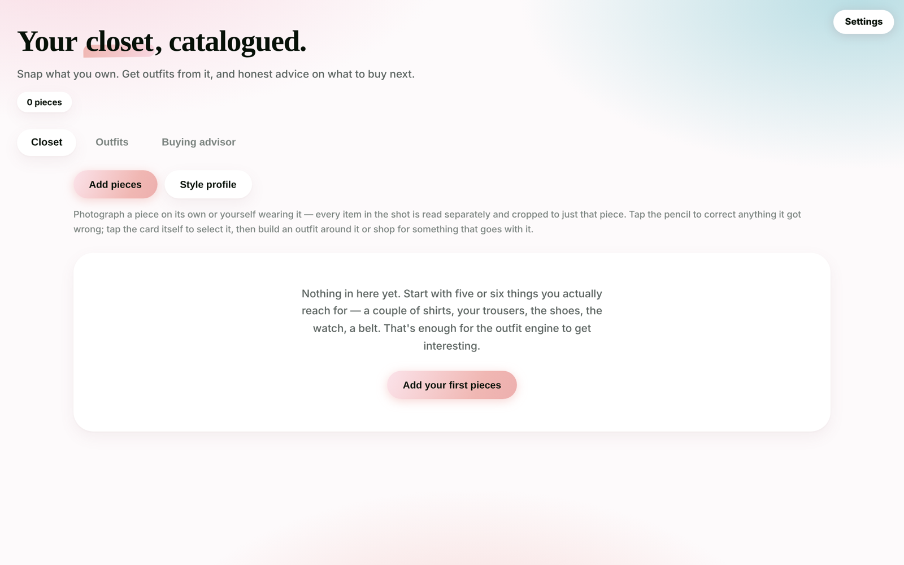

# Wardrobe — AI closet, outfit builder & buying advisor

A personal styling app that turns phone photos of your clothes into a clean, searchable closet, builds outfits from what you already own, and gives honest advice on what to buy next.

Runs as a **single HTML file** with no build step and no backend — in any browser, as an installable PWA, or as a **native Windows app** that works fully offline and uses Claude on your own computer for its AI.



## Features

- **Photo → catalogue.** Photograph a piece on its own or while wearing it; every item in the shot (tops, bottoms, shoes, watches, belts, bags, eyewear) is identified separately with category, colour, fabric, formality and season — all editable, and your edits feed back into every recommendation.
- **On-device background removal.** Each piece is cut out of its photo in the browser (ONNX segmentation model, vendored — no CDN, no upload). A custom matte pipeline on top fixes what the model gets wrong on real-world photos:
  - hysteresis from confident seeds through smooth low-confidence regions,
  - a **coarse-scale texture gate** that tells smooth fabric from busy patterned backgrounds (carpets, rugs),
  - a background colour model sampled from the photo border, used to vote whole regions in or out,
  - colour-outlier rim cleanup, morphological open/close, and anti-aliased edges,
  - and every pixel's colour taken from the **original photo**, never the model output — so cutouts don't come out washed.
- **Outfit builder.** Select pieces and get complete looks built only from your closet, rendered as a flat-lay: layers (jackets, blazers, coats) sit behind the base top, bottoms tuck under the hem, and each shoe has a **layout profile** — how many shoes the photo holds and the camera angle — so a single side-view shoe is mirrored into a natural pair while three-quarter shots aren't.
- **Buying advisor.** Chat with a stylist that reads your catalogue; show it a product photo or a screenshot from a reel and it says whether the piece earns a place next to what you own, and where to find it or a close alternative.
- **Gap analysis.** What's missing from the wardrobe, weighing shoes, watches and belts as seriously as another shirt.
- **Storage that scales.** IndexedDB with sharded image storage (hundreds of high-resolution cutouts), plus backup/restore to a single JSON file.

## AI providers

| Provider | Where it runs | Cost |
| --- | --- | --- |
| **Claude on this PC** | Native app only — requests are handed to the [Claude Code](https://docs.claude.com/en/docs/claude-code/overview) CLI on your machine | Covered by your Claude subscription |
| Google Gemini | Browser → Gemini API | Free tier available |
| Anthropic API | Browser → Anthropic API | Pay per use |

Keys are stored only in the browser's local storage and sent only to the provider you pick.

## Architecture

```
public/index.html       the whole app: React 18 (inlined), UI, AI clients, matte pipeline, IndexedDB store
public/bgr/             vendored @imgly/background-removal + model (generated, see below)
wrapper/main.cpp        native Windows host (Win32 + WebView2)
.github/workflows/      CI that builds the native exe on windows-latest
```

**Native wrapper** (`wrapper/main.cpp`, ~250 lines of C++):
- serves the `app\` folder beside the exe on a private virtual host (`https://wardrobe.local`) via `SetVirtualHostNameToFolderMapping` — fully local, persistent storage, no server;
- per-monitor DPI awareness and a multi-size icon for a crisp taskbar presence;
- a **WebView2 message bridge** to Claude Code: the page posts a request, the wrapper writes the photos to temp files, runs `claude -p` on a background thread with a timeout, and posts the answer back.

## Run it

**In a browser** — serve `public/` with any static server and open it:

```bash
./scripts/vendor-bgr.sh          # once: vendors background removal for offline use
npx serve public
```

**Hosted** — deploys as static assets to Cloudflare Workers (`wrangler.jsonc`), GitHub Pages, Netlify, etc. Put it behind an access gate (e.g. Cloudflare Access) if you want it private; your closet itself never leaves the browser either way.

**Native Windows app** — the CI workflow builds `Wardrobe.exe`. Place it next to an `app\` folder containing the contents of `public/` (including `bgr/`) and run it.

## Privacy

Everything you photograph lives in your browser's IndexedDB on your own device. The host only serves static files. Photos go only to the AI provider you choose — or, with *Claude on this PC*, to the Claude Code CLI on your machine.

## License

MIT
